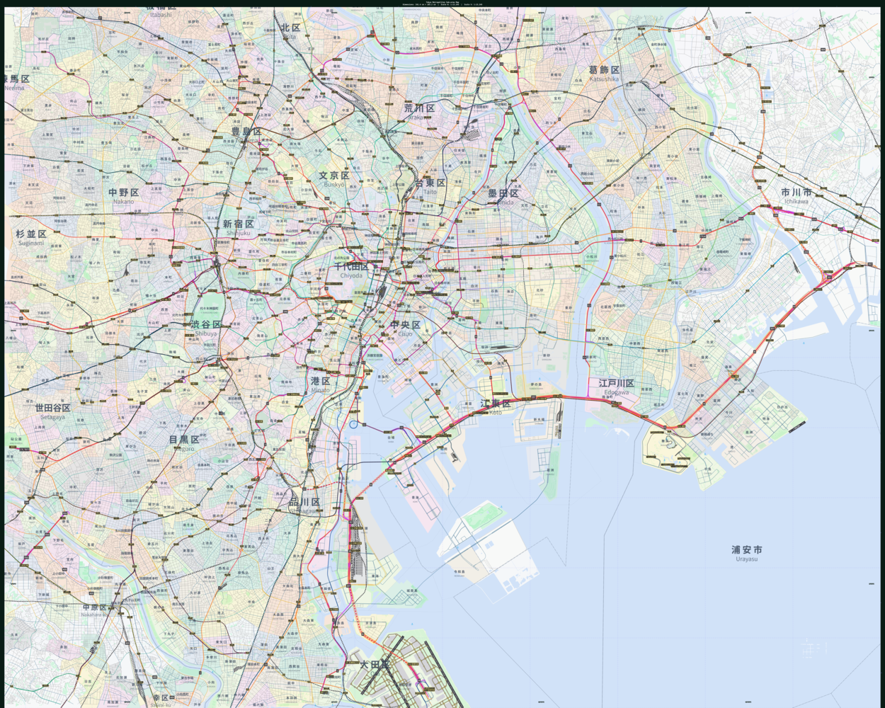

# Cartographer: A modern OOP map plotter

Well, I write this just for hobby because I want to stick something on my room's wall to decorate. So I did this.
This project is based on matplotlib and osmnx.



# Features

This is a robust, object-oriented **g**eographic **i**nformation **s**ystem (GIS) mapping framework built in Python. This project leverages OpenStreetMap (OSM) data via osmnx, alongside geopandas, shapely, and matplotlib, to generate professional-grade, highly aesthetic urban and regional maps.

The framework is strictly built on **Object-Oriented Programming (OOP)** principles. It separates the core physical geography rendering engine from human-geography logic, allowing for highly specialized, region-specific map plotters (e.g., Japan, UK, Hong Kong/Macau) using inheritance.

 - Fluent Interface (Method Chaining): Build maps elegantly by chaining rendering methods sequentially (e.g., `.setup_canvas().draw_land().draw_water().render()`).

 - Smart Z-Order Masking: Automatically clips administrative boundaries and land features underneath water bodies to prevent colors from bleeding into oceans and rivers.

 - Advanced Topographic Rendering: Support for Digital Elevation Models (DEM) via rasterio and earthpy to generate stunning, terrain-aware macro maps with shaded reliefs (hillshading).

 - Dynamic Spatial Indexing: Automatically generates alphanumeric reference grids (e.g., `A1`, `B3`) and perfectly projected WGS84 coordinates (Degree-Minute-Second) along the canvas borders.

 - Multi-Lingual Typography: Employs sophisticated text alignment and halo effects (`path_effects`) to render collision-free, dual-language labels (e.g., Japanese/Romaji, Traditional Chinese/English).

 - Robust Network & Exception Handling: Built-in safe-fetching (`_fetch_features`) that gracefully ignores empty data areas while strictly raising fatal network/API timeout exceptions.

 - Smart OSM Caching: Integrates osmnx caching to prevent redundant API calls, vastly speeding up the styling and iteration process.

# Install

Just clone the repo and install the requirements. If your data source is Overpass API from `https://overpass-api.de`, you can only download 1GB of data per day.
It's strongly recommended to build your own Overpass instance (if you can). [Please read this wiki page.](https://wiki.openstreetmap.org/wiki/Overpass_API)

# Usage examples

### Example 1: Rendering a City Map (Tokyo - `JapanMapPlotter`)

```python
import matplotlib.pyplot as plt
from map_plotters import JapanMapPlotter, decorate_map_layout

# Define Bounding Box (West, South, East, North)
bbox_tokyo = (139.617, 35.543, 139.967, 35.773)

# Initialize the Japan-specific plotter
plotter = JapanMapPlotter(
    bbox=bbox_tokyo,
    bg_color="#dbeafe",   # Water/Ocean color
    land_color="#f8fafc", # Base land color
    projection="utm"
)

# Execute Method Chaining
(plotter.setup_canvas(base_width=100)
        .draw_land()
        .draw_greenery()
        .draw_buildings()
        .draw_water()
        .draw_piers()
        .draw_airports()
        .draw_roads()
        .draw_railways()
        .draw_stations()
        .draw_highway_refs()
        .draw_exits()
        .draw_admins()
        .draw_admin_labels(levels=(4, 6, 7, 8, 9))
        .draw_grid(10, 10, linewidth=2)
        .draw_coordinates()
        .draw_scale()
        .render())

# Add layout decorations and save
decorate_map_layout(plotter.fig, plotter.ax, plotter, "Tokyo Metropolitan Sub-area Map")
plotter.fig.patch.set_facecolor("#091c15")
plt.savefig("tokyo_map.png", dpi=300, facecolor=plotter.fig.get_facecolor(), edgecolor='none')
```

## Example 2:
(...To be continued)

# Advanced operation

### Retrieving Spatial Indexes (Experimental)

After calling .draw_grid(), the plotter automatically indexes the grid cells. You can query the alphanumeric grid coordinate (e.g., C4) for any real-world coordinates:

```python
# Pass True if your inputs are in WGS84 (Longitude, Latitude)
grid_loc = plotter.get_grid_location(x=139.7454, y=35.6586, is_wgs84=True)
print(f"Tokyo Tower is located in grid: {grid_loc}") # Output: Tokyo Tower is located in grid: C2
```

# Contribute

I have only implemented three countries right now. I learned the country-specific features from OpenstreetMap Wiki. If you understand your country very well, you can create a pull request.

# TODO

 - Enable it to draw airports (Fix the incorrect runway size).
 - Enable it to draw macro maps.
 - Enable building indexing system.
 - Polish the scales.
 - Break the Babel, change docstrings to English.
 - ...(Haven't thought of.)